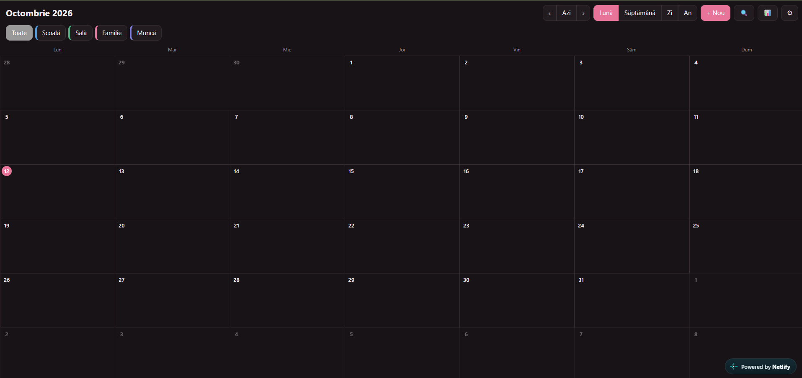
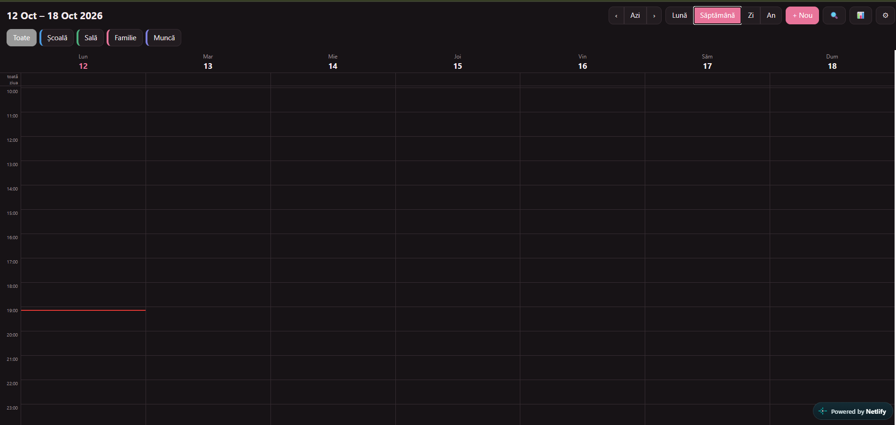
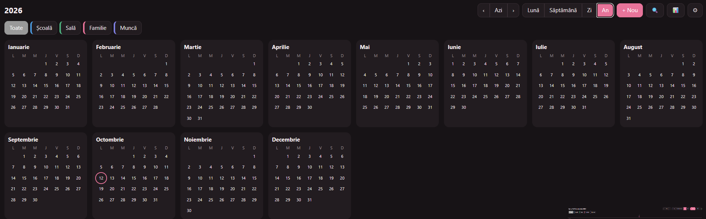

# Planner

I wanted a calendar app I could use every day on my iPad: one where nothing gets deleted by accident and where I can change colors and details however I like. I couldn't find one I liked, so I built my own.

It's a web app that you install on your iPad or iPhone (Add to Home Screen) and it also works offline. No frameworks, just HTML, CSS and plain JavaScript.

**Live version:** http://planner-k7x92m.netlify.app/

## What it can do

- Month, week, day and year views
- Add events with time, location, notes and any color you want
- Repeating events (daily, weekly, monthly, yearly)
- Drag an event to another hour or day, and drag its bottom edge to change the length
- Categories with their own colors, and a filter to show only one category
- A to-do list for each day. If you don't finish a task, it moves to the next day
- Search through events and tasks
- Stats: how many hours I planned for each category (week, month or year)
- 6 themes (including a dark one), 5 fonts, and you can pick the accent color
- Deleted things go to a trash first, so you can get them back
- Backup and import: you copy your data as text and paste it back when you need it

## How it works

Everything is in `index.html`. The data is saved in the browser with `localStorage`, so there's no server and no account. `sw.js` is a service worker that keeps a copy of the files, which is why the app opens without internet. `manifest.webmanifest` and the icons are what make it installable.

## Try it

Open `index.html` in a browser, or open the live link. To install it on iPad or iPhone, open the link in Safari, tap Share, then Add to Home Screen.

## Limits

- The data stays on the device. There is no sync between devices, so use the backup button from time to time
- No notifications yet

## Next things I want to add

- Sync between devices (this needs a backend)
- Reminders before events
- Import/export for Google Calendar (.ics files)

## Note

I built this together with Claude (an AI assistant) and then tested it and customized it myself.
